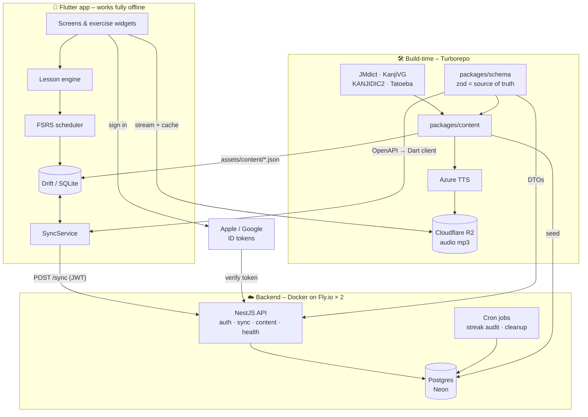
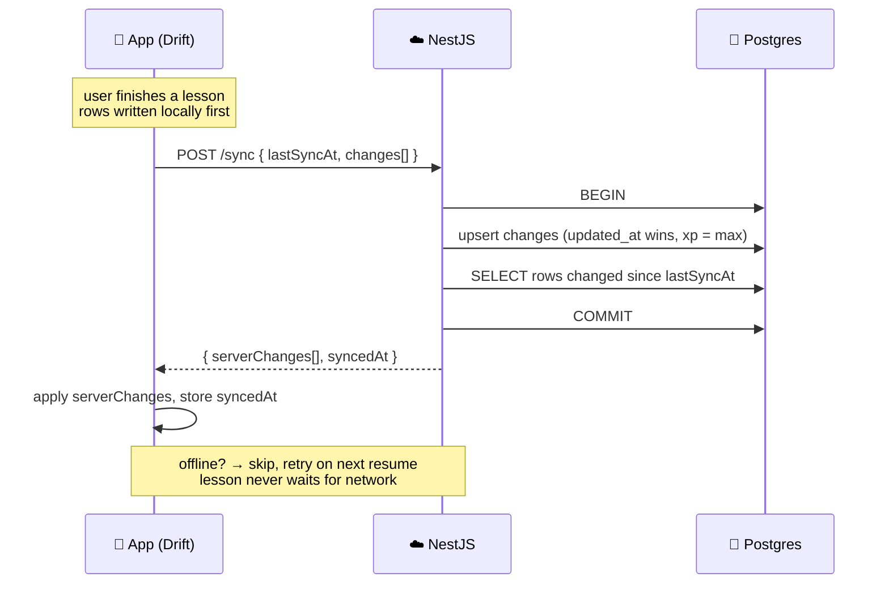
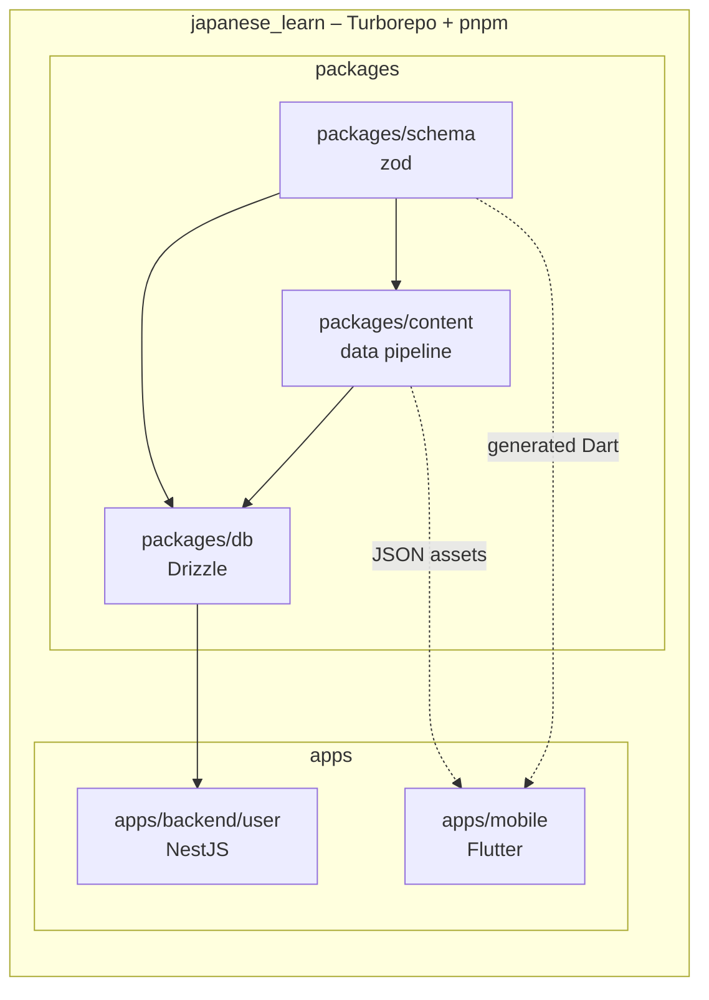
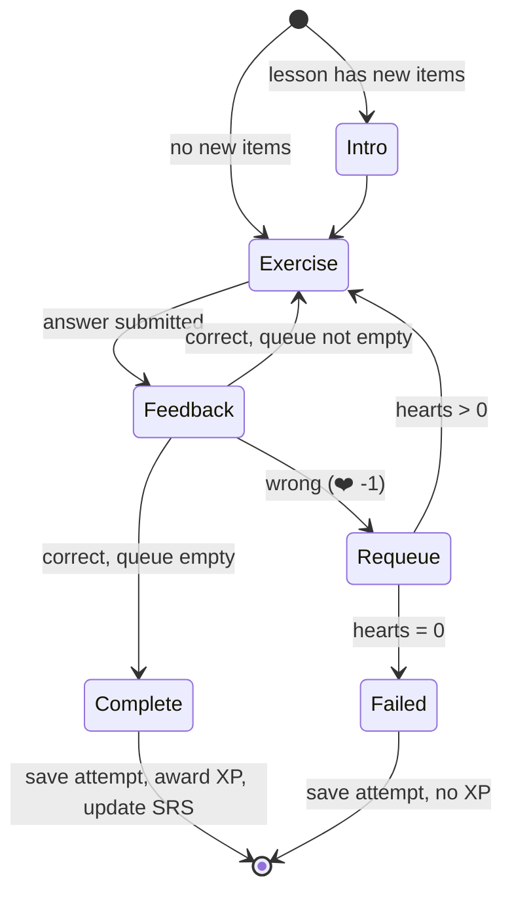
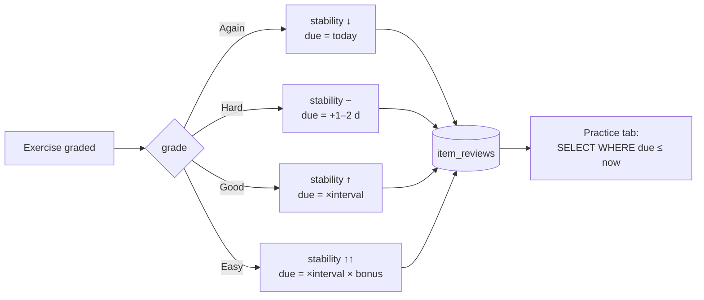
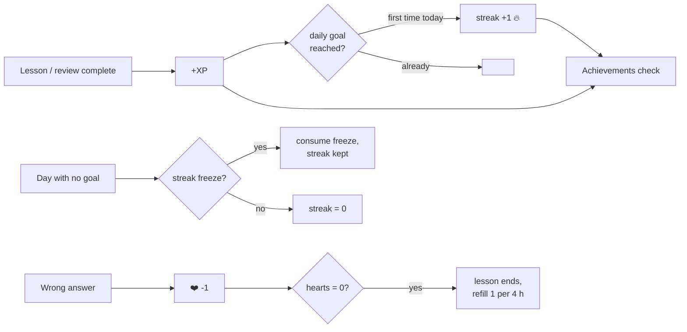

# Japanese Learning App – Build Plan

Duolingo-style mobile app for Japanese. Flutter app inside a Turborepo monorepo,
NestJS + Drizzle + Postgres backend, TypeScript content pipeline.

Work top to bottom. Each phase ends with something runnable. Don't start the next
phase until the checklist for the current one is done.

Legend: `- [ ]` todo · `- [x]` done · **Verify:** lines are the exit criteria for a phase.

---

## Product direction

A general "Duolingo for Japanese" is a crowded market (Duolingo, LingoDeer, Busuu, Anki,
Renshuu, WaniKani, Bunpro). This app aims at a group the big apps don't serve:

- **Who:** Mongolian speakers preparing to study or work in Japan.
- **Goal they pay for:** passing **JFT-Basic** (Specified Skilled Worker route) or **JLPT N5/N4**,
  plus workplace Japanese for their job field and daily-life Japanese for living in Japan.
- **Language:** UI and explanations in **Mongolian first**. English is second. Vietnamese, Nepali,
  Indonesian and Myanmar can follow the same path later.
- **Who pays:** mainly **organisations** – Japanese language schools in Mongolia, recruitment /
  sending agencies, and employers in Japan. Individual subscriptions are secondary.
- **What they pay for:** class groups, teacher dashboards and progress reports (see "Schools" below).

Validate this before building past Milestone 1 (Phase 0 checklist).

---

## At a glance

```mermaid
flowchart LR
    P0[0 Prereqs] --> P1[1 Monorepo]
    P1 --> P2[2 Flutter<br/>foundation]
    P2 --> P3[3 Content<br/>pipeline]
    P3 --> P4[4 Lesson engine<br/>+ kana games]
    P4 --> P5[5 SRS]
    P5 --> P6[6 Gamification]
    P6 --> M1{{🎉 Milestone 1<br/>Offline kana app}}
    M1 --> P7[7 Backend<br/>NestJS + Drizzle]
    P7 --> P8[8 Audio]
    P8 --> P9[9 Polish]
    P9 --> P10[10 Release]
    P10 --> M2{{🚀 Milestone 2<br/>In stores}}
    M2 --> P11[Post-MVP:<br/>vocab · kanji · leagues]

    style M1 fill:#ffe9a8,stroke:#c9a227
    style M2 fill:#c8f7c5,stroke:#3c9d3c
```



| #      | Phase                | What you can do when it's done                            | Rough effort           |
| ------ | -------------------- | --------------------------------------------------------- | ---------------------- |
| 0      | Prerequisites        | Tools installed, accounts created                         | 1 day                  |
| 1      | Monorepo             | `pnpm turbo run lint test` passes, empty Flutter app runs | 1 day                  |
| 2      | Flutter foundation   | Navigation, theme, local DB, settings that persist        | 3–4 days               |
| 3      | Content pipeline     | Lesson JSON generated from real dictionary data           | 4–5 days               |
| 4      | Lesson engine + kana | Play a full hiragana lesson with 5 exercise types         | 1.5–2 weeks            |
| 5      | SRS                  | Practice tab shows due items, weak ones come back sooner  | 3–4 days               |
| 6      | Gamification         | XP, streaks, hearts, achievements, reminders              | 1 week                 |
| **M1** | **Offline kana app** | **Shippable to friends as a TestFlight build**            | **~6 weeks total**     |
| 7      | Backend              | Sign in with Apple/Google, progress syncs between devices | 2 weeks                |
| 8      | Audio                | Native-quality TTS for every item, cached offline         | 2–3 days               |
| 9      | Polish               | Onboarding, animations, analytics, crash reports          | 1 week                 |
| 10     | Release              | Live on App Store + Google Play                           | 1 week + review time   |
| **M2** | **In stores**        |                                                           | **~11–12 weeks total** |

Effort assumes evenings/weekends, one person. Halve it if full-time.

### System architecture



### How sync works



### Where every piece lives



---

## 0. Stack decisions

| Layer            | Choice                                                                                     | Why                                                                                                |
| ---------------- | ------------------------------------------------------------------------------------------ | -------------------------------------------------------------------------------------------------- |
| Monorepo         | Turborepo + pnpm 10                                                                        | Caches Flutter + TS tasks, one `pnpm turbo run test` for everything                                |
| Mobile           | Flutter (Dart 3)                                                                           | One codebase, strong custom drawing (stroke tracing), great animations                             |
| State            | Riverpod 2 (code-gen)                                                                      | Testable, no boilerplate, works well with Drift streams                                            |
| Routing          | go_router                                                                                  | Deep links, typed routes                                                                           |
| Local DB         | Drift (SQLite)                                                                             | Offline-first lessons + SRS, reactive queries                                                      |
| Backend          | NestJS 11 (TypeScript)                                                                     | Shares zod schemas with content pipeline, first-class in Turborepo                                 |
| ORM / migrations | Drizzle ORM + drizzle-kit                                                                  | Typed SQL, migrations in repo, no codegen step                                                     |
| Database         | Postgres 16 (Docker locally, Neon in prod)                                                 | Managed backups + PITR, swap provider via connection string                                        |
| Auth             | Own JWT (access + refresh) issued by API; Apple / Google ID-token verification             | No third-party auth in the request path                                                            |
| Storage          | Cloudflare R2 (S3-compatible)                                                              | Zero egress fees for audio                                                                         |
| Jobs             | @nestjs/schedule (cron) now, BullMQ + Redis when needed                                    | Streak audits, league rollover                                                                     |
| API contract     | oRPC (`@orpc/contract` + zod) in `packages/contract`, implemented in Nest via `@orpc/nest` | Define each endpoint once. OpenAPI generated from it → Dart client; admin gets a typed oRPC client |
| Hosting          | Docker image on Fly.io (2 instances)                                                       | Portable; move to VPS/k8s later without code changes                                               |
| Content pipeline | TypeScript package                                                                         | Builds lesson JSON from JMdict / KanjiVG / KANJIDIC2                                               |
| Audio            | Azure Neural TTS (ja-JP Nanami / Keita) → mp3 in R2                                        | Cheap, near-native quality                                                                         |
| CI               | GitHub Actions                                                                             | Runs `turbo run lint test build`                                                                   |

### Backend architecture

Owned backend: **NestJS + Drizzle + Postgres**, living in `apps/backend/user` (user API; a separate `apps/backend/admin` API comes later). Decision made
after weighing Supabase (fastest, but vendor-shaped), Go (cheapest to run), Java/Spring
(most battle-tested) and C++ (no fit). TypeScript wins because the content pipeline and
schemas are already TypeScript, so one zod definition drives lesson JSON, DB seed, API
DTOs and the generated Dart client.

Principles:

- **Offline-first stays.** SRS and lesson engine run on device. The API stores progress
  snapshots and per-item review state for sync. A backend outage never blocks a lesson.
- **Database is the only managed piece.** Postgres on Neon (backups, PITR, branching).
  Everything else is a Docker image you can run anywhere.
- **Stateless API, two instances.** No in-memory sessions; JWTs + Postgres. Either
  instance can die.
- **Schemas shared, not duplicated.** `packages/schema` (zod) → `packages/db` (Drizzle
  tables) and `packages/contract` (oRPC procedures) → `apps/backend/user` implements the contract →
  OpenAPI → Dart client, and `apps/admin` uses the contract directly. Change it once.
- **Boring observability from day one.** Pino structured logs, `/health` via Terminus,
  Sentry, uptime ping.

---

## 1. Monorepo layout

```
japanese_learn/
├── apps/
│   ├── mobile/                 # Flutter app
│   │   ├── lib/
│   │   ├── test/
│   │   ├── pubspec.yaml
│   │   └── package.json        # exposes flutter commands to turbo
│   └── backend/
│       ├── user/               # NestJS API for the mobile app
│       │   ├── src/
│       │   │   ├── content/    # ✓ read-only content (controller → service → repository)
│       │   │   ├── auth/       # apple/google token verify, jwt issue/refresh
│       │   │   ├── profile/    # me, delete account
│       │   │   ├── sync/       # push/pull progress, item_reviews, review_log
│       │   │   ├── jobs/       # cron: streak audit, cleanup
│       │   │   ├── config/ database/ orpc/ common/ health/ docs/
│       │   │   └── main.ts
│       │   ├── test/           # e2e against the docker-compose Postgres
│       │   ├── Dockerfile
│       │   └── package.json    # name: backend-user
│       └── admin/              # (post-MVP) NestJS API for apps/admin, role-guarded
├── packages/
│   ├── schema/                 # TS: zod schemas (source of truth for content + API DTOs)
│   ├── contract/               # TS: oRPC contract (procedures, paths, input/output)
│   ├── db/                     # TS: Drizzle schema, migrations, db client, seed helpers
│   ├── content/                # TS: raw data → lesson JSON + seeds packages/db
│   ├── eslint-config/
│   └── tsconfig/
├── docker-compose.yml          # local postgres + redis + minio (R2 stand-in)
├── .github/workflows/ci.yml
├── turbo.json
├── pnpm-workspace.yaml
├── package.json
└── PLAN.md
```

Turbo cannot run Dart natively; it just runs the `scripts` in `apps/mobile/package.json`
(`flutter analyze`, `flutter test`, `flutter build …`) and caches by input hash.
That's all you need.

---

## 2. Phase 0 – Prerequisites

- [x] Install Flutter stable (`flutter doctor` fully green for iOS + Android)
- [x] Install Xcode + CocoaPods, Android Studio + SDK + emulator
- [x] Install Node 22 LTS (pinned via `.nvmrc`) and pnpm 10
- [x] Install Docker Desktop (local Postgres, Redis, MinIO)
- [ ] Create GitHub repo `japanese_learn` (private)
- [ ] Create accounts (no setup yet, just so they're ready): Neon, Cloudflare (R2), Fly.io, Sentry
- [ ] Register Apple Developer account (needed for TestFlight, takes a few days to approve)
- [ ] Register Google Play developer account

**Market check (in parallel with Phases 1–6)**

- [ ] Interview 5–10 Japanese language schools / sending agencies in Mongolia: what they use, where students fail, would they pay, how much
- [ ] Mongolian landing page with an email / phone sign-up; measure interest
- [ ] Find one school willing to pilot the Milestone 1 app with a real class for a month

---

## 3. Phase 1 – Initialize the monorepo

- [x] `git init`, add `.gitignore` (Node + Flutter + macOS + `.env*`)
- [x] `pnpm init` at root, add `"private": true`, `"packageManager": "pnpm@10.x"`
- [x] Create `pnpm-workspace.yaml` with `apps/*`, `packages/*`
- [x] `pnpm add -D turbo -w`
- [x] Create `turbo.json` with tasks: `lint`, `test`, `build`, `gen`, `format`
  - `build` depends on `^build`, outputs: `build/**`, `dist/**`
  - `gen` (codegen) depends on nothing, outputs: `lib/**/*.g.dart`, `lib/**/*.freezed.dart`
- [x] `flutter create apps/mobile --org com.bilguun --project-name nihongo --platforms ios,android` (bundle id `com.bilguun.nihongo`)
- [x] Add `apps/mobile/package.json`:
  ```json
  {
    "name": "mobile",
    "private": true,
    "scripts": {
      "gen": "dart run build_runner build --delete-conflicting-outputs",
      "lint": "flutter analyze",
      "format": "dart format --set-exit-if-changed lib test",
      "test": "flutter test",
      "build": "flutter build apk --debug",
      "build:ios": "flutter build ipa --release",
      "build:android": "flutter build appbundle --release"
    }
  }
  ```
- [x] Create `packages/tsconfig` with `base.json`, `nestjs.json`, `library.json`
- [x] Create `packages/eslint-config` (typescript-eslint, shared across TS packages)
- [x] Create `packages/schema` (TS, zod, vitest) – empty for now
- [x] Create `packages/db` (TS, drizzle-orm, drizzle-kit, postgres driver) – empty for now
- [x] Create `packages/content` (TS, tsx runner, vitest) – empty for now
- [x] Create `packages/contract` (`@orpc/contract`, `@orpc/openapi`, zod from `packages/schema`)
- [x] Add root `docker-compose.yml`: `postgres:16`, `redis:7`, `minio` (S3 stand-in for R2)
- [x] Add `.env.example` at root; real `.env` git-ignored
- [x] Add root `.prettierrc`, `.editorconfig`
- [x] Add GitHub Actions `ci.yml`: setup pnpm + Flutter, run `pnpm turbo run lint test`
- [x] Verify: `pnpm turbo run lint test` passes from clean clone
- [ ] First commit

---

## 4. Phase 2 – Flutter app foundation

Goal: empty app with navigation, theming, DI, local DB, and a settings screen that persists.

- [ ] Add dependencies: `flutter_riverpod`, `riverpod_annotation`, `go_router`, `drift`, `sqlite3_flutter_libs`, `path_provider`, `freezed_annotation`, `json_annotation`, `flutter_animate`, `google_fonts`
- [ ] Add dev deps: `build_runner`, `riverpod_generator`, `freezed`, `json_serializable`, `drift_dev`, `mocktail`, `very_good_analysis` (lint rules)
- [ ] Decide folder structure (feature-first):
  ```
  lib/
  ├── app/            # MaterialApp, router, theme
  ├── core/           # db, utils, extensions, constants
  ├── features/
  │   ├── onboarding/
  │   ├── home/       # learning path
  │   ├── lesson/     # lesson engine + exercise widgets
  │   ├── review/     # SRS practice
  │   ├── profile/
  │   └── settings/
  └── main.dart
  ```
- [ ] Set up `go_router` with routes: `/onboarding`, `/home`, `/lesson/:id`, `/review`, `/profile`, `/settings`
- [ ] Bottom nav shell: Learn · Practice · Profile
- [ ] Theme: pick a palette, define `ColorScheme` light + dark, a Japanese-capable font (Noto Sans JP via `google_fonts`)
- [ ] Set up Drift database class with a `schemaVersion` and migration strategy
- [ ] Add a `settings` table (daily goal, sound on/off, furigana mode, theme)
- [ ] Settings screen reads/writes via Riverpod + Drift stream
- [ ] Localisation from day one: `flutter_localizations` + ARB files, **`mn` default**, `en` second; no hard-coded UI strings
- [ ] Add a `flavors` setup: `dev` (API on localhost) and `prod` (Fly.io API)
- [ ] Add `flutter_native_splash` + app icon placeholder
- [ ] Write one widget test and one Drift unit test so the test pipeline is proven
- [ ] Verify: app runs on iOS simulator and Android emulator, settings persist across restart

---

## 5. Phase 3 – Content schema & pipeline

Goal: lesson content is generated JSON, not hand-written Dart.

### packages/schema

- [ ] Define zod schemas:
  - `Kana { id, char, romaji, type: hiragana|katakana, row, audio }`
  - `Kanji { id, char, meanings[], onyomi[], kunyomi[], strokes (KanjiVG paths), jlpt, grade }`
  - `Vocab { id, word, reading, meanings[], kanjiIds[], jlpt, audio }`
  - `Sentence { id, ja, reading, en, tokens[], vocabIds[], audio }`
  - `Exercise` discriminated union (see Phase 4 list)
  - `Lesson { id, unitId, title, order, exercises[], newItemIds[] }`
  - `Unit { id, title, order, lessons[] }`
  - `Course { units[] }`
- [ ] Export JSON Schema from zod (`zod-to-json-schema`) → used to generate Dart models
- [ ] Tests: every fixture validates

### packages/content

- [ ] Script `download.ts`: fetch JMdict (JSON build from `scriptin/jmdict-simplified`), KANJIDIC2, KanjiVG, Tatoeba ja-en pairs → `packages/content/raw/` (git-ignored)
- [ ] `build-kana.ts`: hand-authored kana table (46 + dakuten + combos, both scripts) → `kana.json`
- [ ] `build-kanji.ts`: filter N5 kanji (~80), attach KanjiVG stroke paths → `kanji.json`
- [ ] `build-vocab.ts`: curated N5 vocab list (~700) joined to JMdict → `vocab.json`
- [ ] `build-sentences.ts`: pick Tatoeba sentences using only known vocab → `sentences.json`
- [ ] `build-course.ts`: authored YAML course outline → generates `Lesson` JSON with exercises
- [ ] Output everything to `apps/mobile/assets/content/` and `packages/db/seed/`
- [ ] Add `content:build` turbo task; mobile `build` depends on it
- [ ] Author the first course outline aimed at JFT-Basic / N5: Unit 1–5 hiragana rows, Unit 6–10 katakana, Unit 11 greetings & self-introduction. Explanations and mnemonics in Mongolian (English as second language)
- [ ] Verify: `pnpm turbo run content:build` produces valid JSON, Flutter can load it

### Flutter side

- [ ] Generate Dart models (freezed) matching the schema
- [ ] `ContentRepository` loads JSON from assets into Drift on first launch (versioned, re-import on content bump)
- [ ] Unit test: all bundled lessons parse

---

## 6. Phase 4 – Lesson engine + kana exercises (the MVP core)

Goal: complete a hiragana lesson start to finish.

```
 Home / path                 Lesson                      Complete
┌──────────────┐    ┌──────────────────────┐    ┌──────────────────┐
│ 🔥 3  ⭐120   │    │ ✕  ████████░░░  ❤️❤️❤️ │    │   🎉 Lesson done  │
│──────────────│    │                      │    │                  │
│ Unit 1 あ行   │    │  Which sound is this?│    │   +12 XP         │
│   (✓)        │    │        ┌────┐        │    │   92% accuracy   │
│   (✓)        │ →  │        │ あ │        │ →  │   1m 48s         │
│   (▶) ←tap   │    │        └────┘        │    │                  │
│   (🔒)       │    │  [ a ] [ i ] [ u ] [ e ]│    │  [ CONTINUE ]    │
│ Unit 2 か行   │    │                      │    │                  │
│   (🔒)       │    │ ┌──────────────────┐ │    └──────────────────┘
│              │    │ │ ✓ Correct!       │ │
└──────────────┘    │ └──────────────────┘ │
                    └──────────────────────┘
```

Lesson flow inside the engine:



### Engine

- [ ] `LessonController` (Riverpod notifier): queue of exercises, current index, hearts, mistakes, result
- [ ] Wrong answers get re-queued at the end of the lesson (Duolingo behaviour)
- [ ] Lesson screen shell: progress bar, hearts, close button with "are you sure" sheet
- [ ] Answer feedback banner (green/red slide-up, correct answer shown, haptic + sound)
- [ ] Lesson complete screen: XP earned, accuracy, time, confetti
- [ ] Persist lesson result to Drift (`lesson_attempts`)

### Exercise widgets (kana MVP)

- [ ] `MatchPairs` – 5 kana ↔ 5 romaji tiles, tap to pair
- [ ] `MultipleChoice` – show kana, pick romaji from 4 (and reverse)
- [ ] `ListenAndSelect` – play audio, pick the kana
- [ ] `ListenAndType` – play audio, type romaji (custom on-screen keyboard, no IME)
- [ ] `TraceStroke` – draw the character over a KanjiVG guide; score by stroke count + per-stroke direction similarity
- [ ] `NewItemIntro` – non-graded card introducing a new kana with audio + mnemonic
- [ ] Exercise picker: lesson JSON decides types; widget factory maps `type` → widget

### Home / path

- [ ] Learning path screen: vertical list of unit → lesson nodes, locked / available / completed states
- [ ] Unit header with title and colour
- [ ] Tapping an available node starts the lesson
- [ ] Verify: new user can do Unit 1 Lesson 1 → 5 and the path unlocks progressively

---

## 7. Phase 5 – Spaced repetition



- [ ] Drift table `item_reviews { itemId, itemType, stability, difficulty, due, lastReview, reps, lapses }`
- [ ] Implement FSRS (port `fsrs.js` scheduler; ~200 lines) as a pure Dart class with unit tests against known vectors
- [ ] Every graded exercise reports `(itemId, grade)` → scheduler updates review row
- [ ] "Practice" tab: shows count of due items, starts a review session built from due items (mixed exercise types)
- [ ] Weak-items session when nothing is due
- [ ] Verify: an item answered wrong appears again sooner than one answered right

---

## 8. Phase 6 – Gamification



- [ ] `user_stats` table: totalXp, currentStreak, longestStreak, lastActiveDate, hearts, heartsRefillAt, gems
- [ ] XP: 10 per lesson + bonus for perfect, 5 per review session
- [ ] Daily goal ring on Home header (10/20/30/50 XP options)
- [ ] Streak: increments on first goal completion per local day; resets if a day is missed; streak freeze item
- [ ] Hearts: 5 max, lose 1 per mistake, 1 refills every 4 h, lesson ends at 0; practice mode is free
- [ ] Achievements table + 10 starter achievements (first lesson, 7-day streak, all hiragana, perfect lesson, …)
- [ ] Profile screen: stats, achievements grid, calendar heatmap of activity
- [ ] Daily reminder local notification (`flutter_local_notifications`), time chosen in settings
- [ ] Verify: streak survives app kill, breaks correctly after a skipped day (test with fake clock)

---

## 9. Phase 7 – Backend (NestJS + Drizzle + Postgres)

Goal: accounts, cloud sync, audio hosting. App must still work fully offline.
Done in four sub-steps, each deployable on its own.

### 7a. Database package (`packages/db`)

- [x] Drizzle schema files, one per domain:
  - `users (id uuid pk, email unique null, apple_sub unique null, google_sub unique null, username, avatar_key, created_at, deleted_at)`
  - `refresh_tokens (id, user_id fk, token_hash, device_id, expires_at, revoked_at)`
  - `user_stats (user_id pk, total_xp, current_streak, longest_streak, last_active_date, streak_freezes, hearts, hearts_refill_at, updated_at)`
  - `lesson_progress (user_id, lesson_id, completed_at, best_accuracy, attempts, updated_at, pk(user_id, lesson_id))`
  - `item_reviews (user_id, item_id, item_type, stability, difficulty, due, last_review, reps, lapses, updated_at, pk(user_id, item_id))`
  - `achievements_unlocked (user_id, achievement_id, unlocked_at, pk(user_id, achievement_id))`
  - `review_log (id, user_id, item_id, exercise_type, grade, correct, response_ms, reviewed_at, client_tz, app_version)` – append-only history of every answer. Synced with progress. Cheap now, impossible to backfill later; the ML work depends on it
  - `sync_log (user_id, device_id, synced_at)`
  - Content tables: `kana`, `kanji`, `vocab`, `sentences`, `units`, `lessons` (jsonb payload + version) – read-only to clients, lets you ship content without an app release
- [x] Indexes: `item_reviews(user_id, due)`, `item_reviews(user_id, updated_at)`, `lesson_progress(user_id, updated_at)`
- [x] `drizzle.config.ts`, scripts: `db:generate`, `db:migrate`, `db:studio`, `db:seed`
- [ ] Zod ↔ Drizzle bridge with `drizzle-zod` so insert/select types reuse `packages/schema` (when first DTO needs it)
- [x] `seed.ts` imports `packages/content` output into content tables
- [x] Verify: `docker compose up -d && pnpm db:migrate && pnpm db:seed` on a clean DB

### 7b. API skeleton (`apps/backend/user`)

- [x] NestJS 12 (ESM) in `apps/backend/user`, pnpm workspace, strict TS, `@repo/*` workspace deps
- [x] Config module with zod-validated env (base vars done; add `JWT_SECRET`, `R2_*`, `APPLE_CLIENT_ID`, `GOOGLE_CLIENT_ID`, `SENTRY_DSN` as features land)
- [x] `DrizzleModule`: global provider wrapping `packages/db` client with connection pool
- [x] Pino logger (`nestjs-pino`), request id, redaction of auth headers
- [x] `GET /health` (Terminus: db ping), `GET /ready`
- [x] `ZodValidationPipe` (own, ~20 lines; nestjs-zod doesn't support Nest 12) – DTOs come from `packages/schema`
- [x] Global exception filter → RFC 7807 problem+json
- [ ] Rate limiting (`@nestjs/throttler`) on auth routes
- [x] `@nestjs/swagger` wired, OpenAPI JSON emitted at build (`openapi.json` as turbo output)
- [x] Turbo tasks: `lint`, `test`, `test:e2e`, `build`, `openapi`
- [x] e2e test harness against the docker-compose Postgres (fresh `nihongo_test` DB per run); CI uses a Postgres service container
- [x] Multi-stage `Dockerfile` (pnpm fetch → build → node:22-slim runtime, non-root user)
- [x] Verify: `docker build` + run container → `/health` returns 200

### 7b′. Move the API onto oRPC (do this before 7c, while only 3 endpoints exist)

Why: one contract defines path, input and output for every endpoint. The backend implements it,
the OpenAPI spec is generated from it, the Dart client is generated from that spec, and the
admin app imports the contract for a fully typed client with no codegen.

```
packages/schema (zod) ─▶ packages/contract (oRPC) ─┬─▶ apps/backend/user  @Implement in Nest controllers
                                                   ├─▶ openapi.json  ─▶ Dart client (apps/mobile)
                                                   └─▶ apps/admin    typed oRPC client
```

- [x] `packages/contract`: `content.manifest`, `content.kana` procedures with `openapi.path` meta and zod output schemas
- [x] `apps/backend/user`: add `@orpc/nest`, `@orpc/server`, `@orpc/openapi`; register `ORPCModule`
- [x] Content controller implements the contract with `@Implement(contract.content.*)`; health endpoints stay plain Nest
- [x] Generate `openapi.json` with `@orpc/openapi`'s generator; drop `@nestjs/swagger` decorators and `ZodValidationPipe`
- [x] Serve API reference in dev: Scalar at `/docs`, spec at `/openapi.json`
- [x] problem+json for oRPC errors via `sendResponseInterceptors` (oRPC 1.16 has no Rethrow plugin; that's in the 2.x beta)
- [x] Body size capped by Nest's JSON body parser (100 kb), kept on instead of `bodyParser: false`; oRPC 1.16 has no Request Limit plugin
- [x] Update e2e tests; guards and pipes only run over HTTP, not in `call()` unit tests
- [x] Verify: `/v1/content/*` responses unchanged, `openapi.json` paths unchanged, e2e green

### 7c. Auth

- [ ] Contracts `auth.apple`, `auth.google`, `auth.refresh`, `auth.logout`, `auth.logoutAll`, `users.deleteMe` in `packages/contract`
- [ ] `POST /auth/apple` – verify Apple identity token (`apple-signin-auth`), upsert user by `apple_sub`
- [ ] `POST /auth/google` – verify Google ID token (`google-auth-library`), upsert user by `google_sub`
- [ ] Issue access JWT (15 min) + opaque refresh token (30 days, hashed in `refresh_tokens`, rotated on use, per device)
- [ ] `POST /auth/refresh`, `POST /auth/logout` (revoke device), `POST /auth/logout-all`
- [ ] `JwtAuthGuard` + `@CurrentUser()` decorator
- [ ] `DELETE /users/me` – soft delete + purge job after 30 days (App Store requirement)
- [ ] Guest → account merge: `POST /auth/apple|google` accepts optional `guestSnapshot`, merged on first sign-in
- [ ] Flutter: `sign_in_with_apple`, `google_sign_in`, secure token storage (`flutter_secure_storage`), Dio interceptor for refresh
- [ ] Guest mode first: no account required. Prompt to create one after Unit 1 ("save your progress")
- [ ] Verify: sign in on simulator, token refresh works after access token expiry, logout revokes

### 7d. Sync

- [ ] Contract `sync.push` in `packages/contract`; zod input/output reused from `packages/schema`
- [ ] `POST /sync` – body `{ deviceId, lastSyncAt, changes: { userStats?, lessonProgress[], itemReviews[], achievements[] } }`
  - server applies pushes with per-row conflict rule: `updated_at` last-write-wins for progress/reviews, `max()` for xp/streak, union for achievements
  - returns rows changed on server since `lastSyncAt` + new `syncedAt`
- [ ] Single transaction per sync call; idempotent (replaying same push is a no-op)
- [ ] `GET /content/manifest` – content version + per-table checksums; `GET /content/:table` – paged rows. App re-imports when version bumps
- [ ] Flutter `SyncService`: runs on login, app resume, lesson complete, review complete; retries with backoff; never blocks UI
- [ ] Generate Dart client from `openapi.json` (`openapi-generator` dart-dio) into `apps/mobile/lib/api/` as a turbo task depending on `backend#openapi`
- [ ] Verify: complete lessons on device A, log in on device B, progress appears; go offline on A, do lessons, come back → merges cleanly

### 7e. Storage, jobs, deploy

- [ ] R2 bucket `nihongo-media` (public read via custom domain), MinIO locally with same bucket name
- [ ] `StorageService` using `@aws-sdk/client-s3`; presigned upload for avatars
- [ ] Cron jobs (`@nestjs/schedule`, leader-elected via Postgres advisory lock so 2 instances don't double-run):
  - 00:05 per timezone bucket: streak audit, consume streak freeze or reset
  - hourly: purge soft-deleted users past 30 days, expire refresh tokens
- [ ] Neon project: `main` branch for prod, `dev` branch for staging; `DATABASE_URL` per env
- [ ] Fly.io app: 2 machines (`shared-cpu-1x`), `fly.toml` with health checks, secrets via `fly secrets`
- [ ] GitHub Actions `deploy-api.yml`: on tag `api-v*` → test → build image → `fly deploy` → run migrations as release command
- [ ] Sentry (`@sentry/nestjs`) + uptime monitor on `/health` (Better Stack free tier)
- [ ] Backups: confirm Neon PITR enabled; test a restore once and write down the steps
- [ ] Verify: prod `/health` green, Flutter prod flavor syncs against it

---

## 10. Phase 8 – Audio

- [ ] Script `packages/content/gen-audio.ts`: for every kana/vocab/sentence without audio, call Azure TTS (ja-JP-NanamiNeural), save mp3, upload to R2 via `StorageService` logic (shared S3 helper in `packages/db` or a tiny `packages/storage`), write key back into content JSON
- [ ] Bundle kana audio in app assets (tiny); stream vocab/sentence audio with on-device cache (`just_audio` + `flutter_cache_manager`)
- [ ] Slow-speed replay button (turtle) on listening exercises
- [ ] Correct/incorrect/complete SFX
- [ ] Verify: airplane mode → kana lessons still have audio

---

## 11. Phase 9 – Polish & instrumentation

- [ ] Onboarding flow: why learning, daily goal pick, notification permission, optional sign-in
- [ ] Animations: path node pop, XP count-up, streak flame, heart loss shake
- [ ] Haptics on answer
- [ ] Empty states, error states, offline banner
- [ ] Accessibility: semantics labels, font scaling, reduce-motion respected
- [ ] Review all Mongolian and English strings with a native speaker / teacher (localisation itself starts in Phase 2)
- [ ] Analytics: PostHog (self-host or cloud), events: lesson_start, lesson_complete, exercise_answer, streak_lost
- [ ] Crash reporting: Sentry
- [ ] Performance pass: 60 fps on a mid-range Android device, cold start < 2 s
- [ ] Privacy policy + terms page (required by both stores)

---

## 12. Phase 10 – Release

- [ ] App name, bundle IDs, icons (all sizes), splash
- [ ] iOS: signing, capabilities (Sign in with Apple, Push), `flutter build ipa`, upload to TestFlight
- [ ] Android: upload key, `flutter build appbundle`, Play Console internal testing track
- [ ] Store listings: screenshots (use `screenshots` package or Fastlane), description, keywords
- [ ] Fastlane lanes for both platforms, wired into GitHub Actions on tag
- [ ] Closed beta with 10–20 testers for 2 weeks; fix top issues
- [ ] Public release

---

## 13. Post-MVP roadmap (pick in order of user feedback)

- [ ] Vocab & grammar units (N5): `WordBank` sentence builder, `FillParticle`, `Translate`
- [ ] Kanji track: `KanjiReading`, `KanjiMeaning`, tracing with stroke-order enforcement
- [ ] Speaking exercises (`speech_to_text`, ja-JP)
- [ ] Furigana toggle per-item based on SRS mastery
- [ ] Leagues: weekly cohorts of 30, `leagues` + `league_members` tables, cron rollover job, WebSocket gateway (`@nestjs/websockets`) for live leaderboard
- [ ] Friends & friend streaks
- [ ] Stories (short dialogues with comprehension questions)
- [ ] Timed Blitz mode for kana/vocab
- [ ] Counters & numbers mini-game
- [ ] Monetisation: Super tier (unlimited hearts, no ads, offline packs) via RevenueCat
- [ ] **Schools (B2B): organisations, classes, teacher dashboard – see breakdown below. Likely the first thing customers pay for**
- [ ] Admin panel (`apps/admin`, Next.js) – see breakdown below
- [ ] Machine learning (`apps/ml`, Python) – see breakdown below
- [ ] Course tracks: JFT-Basic mock tests, JLPT N4, workplace Japanese per job field (nursing care, food service, construction…), daily life in Japan
- [ ] Move cron jobs to BullMQ + Redis when they need retries/visibility; move audio generation there too
- [ ] Read replicas / connection pooling (PgBouncer or Neon pooler) when sync traffic grows

---

### Admin panel (post-MVP)

One web app in `apps/admin`, talking only to the admin API in `apps/backend/admin` (separate NestJS app, same packages). No direct DB access from the browser.

```
apps/admin (Next.js)  ──HTTPS + admin JWT──▶  apps/backend/admin /v1/admin/*  ──▶  Postgres
```

**Foundation**

- [ ] `role` enum on `users` (`user`, `support`, `admin`) + migration
- [ ] `RolesGuard` + `@Roles('admin')` decorator in backend; all admin routes under `/v1/admin`
- [ ] Admin sign-in (Google workspace account or email magic link), separate from the app's Apple/Google flow
- [ ] `admin_audit_log (id, admin_id, action, target_user_id, payload jsonb, created_at)` – every admin write is logged
- [ ] Scaffold `apps/admin` with Next.js + typed oRPC client (`@orpc/client`) importing `packages/contract`; admin procedures live under `admin.*`

**User management**

- [ ] User list: search by email / username / id, filter by created date, last active, streak
- [ ] User detail: profile, stats, streak history, lesson progress, devices (refresh tokens), sync log
- [ ] Actions: suspend / unsuspend, revoke all sessions, restore a lost streak, grant gems / streak freezes, delete account (with confirm)
- [ ] Support notes on a user (visible to support + admin)

**Content management**

- [ ] Browse / edit kana, kanji, vocab, sentences, lessons (validated by `packages/schema`)
- [ ] Publish flow: draft → preview → bump `content_manifest.version` (apps pick it up on next sync)

**Insights**

- [ ] Dashboard: DAU / WAU, signups, lesson completions, streak distribution, retention (D1 / D7 / D30)
- [ ] Hardest items: exercises with the highest error rate, to fix content

### Schools (B2B)

Schools and agencies buy seats for their students and want to see progress. Built on the same
backend and the admin web app.

- [ ] `organizations`, `org_members (role: owner | teacher | student)`, `classes`, `class_members` tables
- [ ] Join a class with an invite code or QR in the mobile app
- [ ] Teacher view (web, in `apps/admin` with an org-scoped role): class roster, streaks, lessons done, weak items per student
- [ ] Assign homework: a set of lessons / review targets with a due date
- [ ] Progress report export (PDF / CSV) per student and per class, in Mongolian
- [ ] Seat-based licensing: org buys N seats for a period; students in a class get premium features
- [ ] Mock-test mode with JFT-Basic-style sections and a score report

### Machine learning (post-MVP, `apps/ml`)

Python service, managed with `uv`, FastAPI for the few live endpoints. Lives in the monorepo
with a small `package.json` so Turbo runs its lint/test/build, like `apps/mobile`. Mostly batch
jobs that read Postgres (a read replica later) and write results back to tables the NestJS
backend reads. The mobile app never calls Python directly; live calls go through the oRPC
contract. Models used during lessons run on device so lessons stay offline.

```
review_log ─▶ apps/ml (batch) ─▶ fsrs_params, item_difficulty tables ─▶ backend ─▶ app (via sync)
app ─audio─▶ backend ─▶ apps/ml /score-pronunciation (live)
apps/ml (training) ─▶ .tflite / Core ML ─▶ bundled in apps/mobile (on device)
```

In order of value:

- [ ] **Personal FSRS parameters**: nightly job runs the FSRS optimizer per user from `review_log`, stores `fsrs_params`, app picks them up on sync
- [ ] **Handwriting recognition** for kana/kanji tracing: train in Python, export to TensorFlow Lite / Core ML, run on device
- [ ] **Item difficulty & content quality**: flag exercises with unusual error rates; shown in the admin panel
- [ ] **Churn prediction**: score users at risk of breaking their streak; better-timed reminders
- [ ] **Pronunciation scoring** (server): ASR (e.g. Whisper) + alignment; pitch-accent feedback later
- [ ] **LLM practice** via the Claude API in the NestJS backend (no Python needed): grammar explanations in Mongolian, short role-play dialogues
- [ ] Docker image for `apps/ml`, added to `docker-compose.yml`; separate Fly.io app in prod

Skip until there are many users: custom recommendation engines, training own language models.

## Working rules

- One phase per branch, PR to `main`, CI green before merge.
- Every exercise type gets a widget test with a fake controller.
- Content changes never require Dart changes. If they do, the schema is wrong.
- Keep the app usable with zero network until Phase 7, and after Phase 7 too.
- Every API change starts in `packages/contract` (oRPC, with zod from `packages/schema`); regenerate the Dart client, never hand-edit it.
- Backend layers: controller (oRPC contract) → service (business rules, never touches the DB) → repository (`*.repository.ts`, the only code that imports Drizzle). Enforced by ESLint.
- Migrations are forward-only and reviewed; no `drizzle-kit push` against prod.
